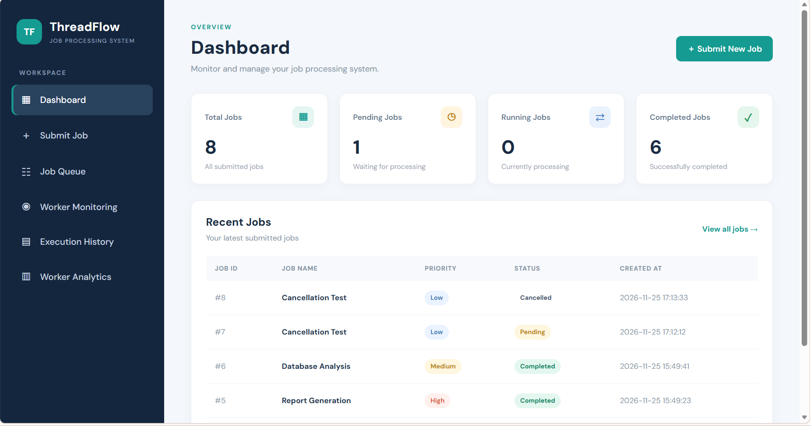
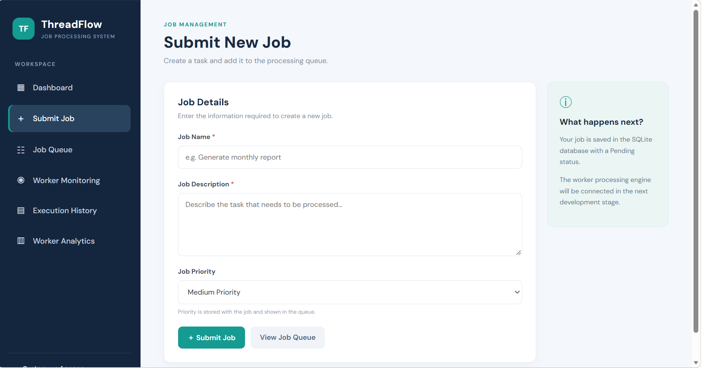
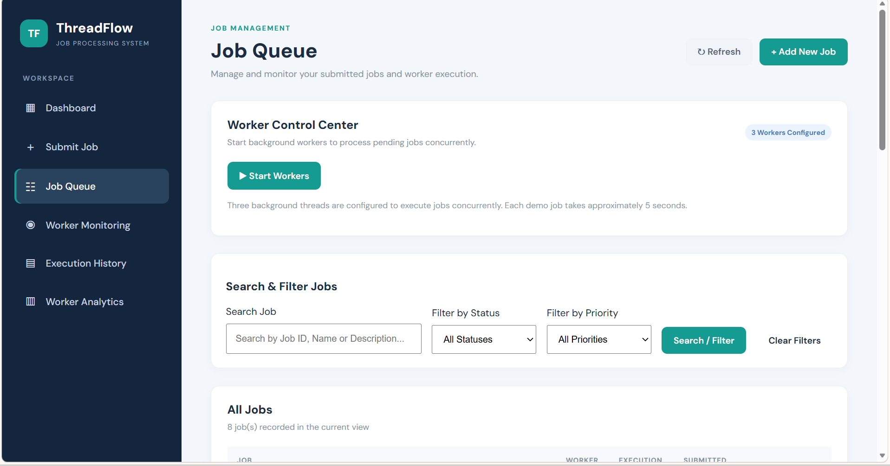
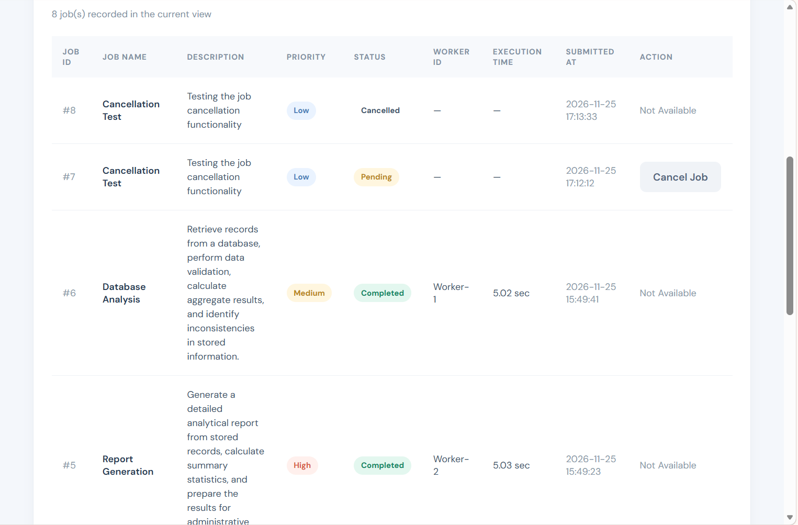
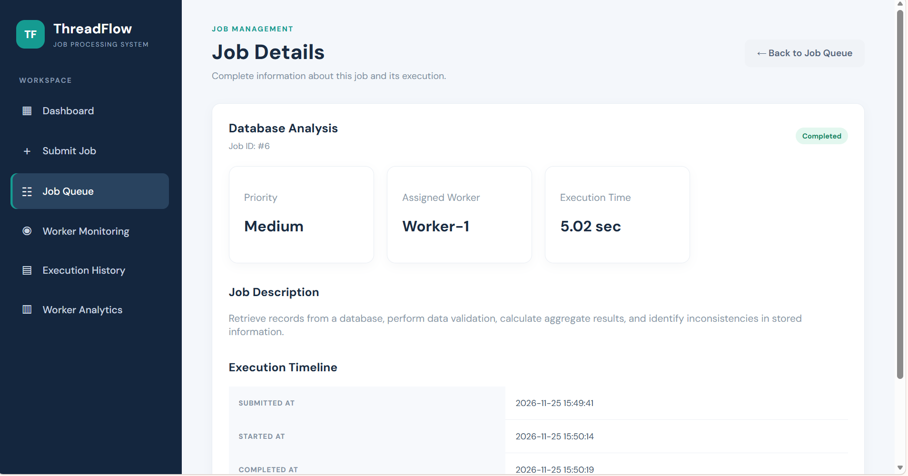
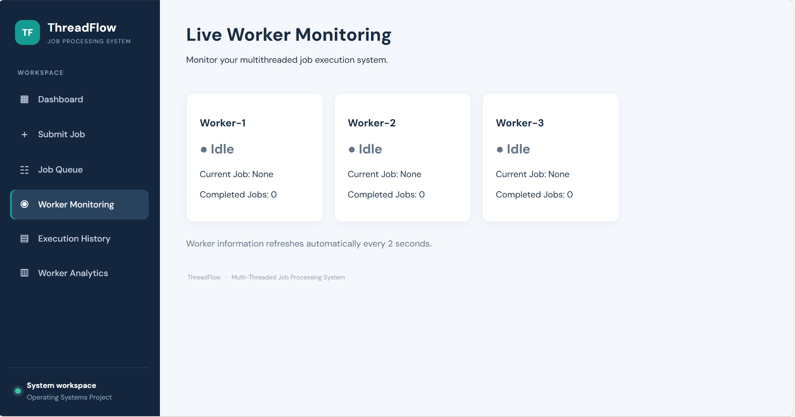
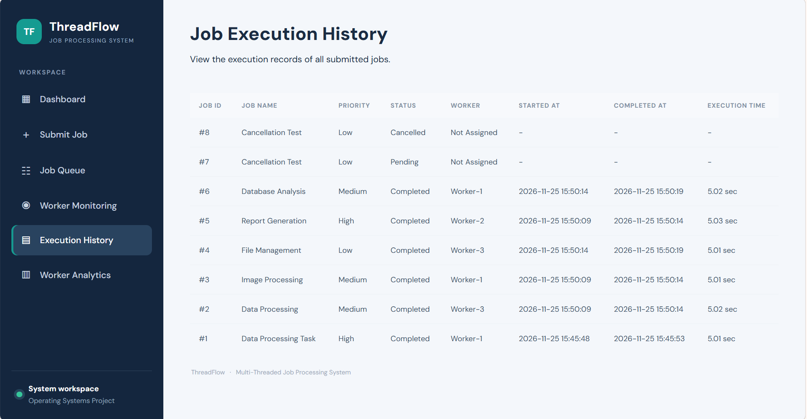
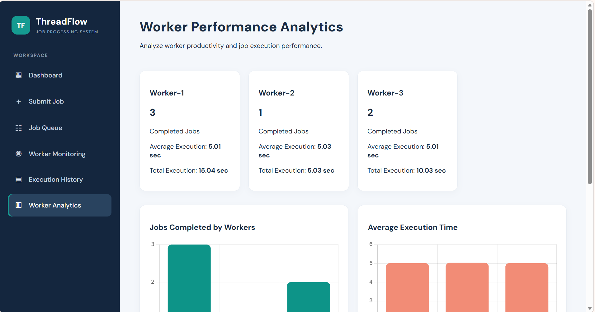
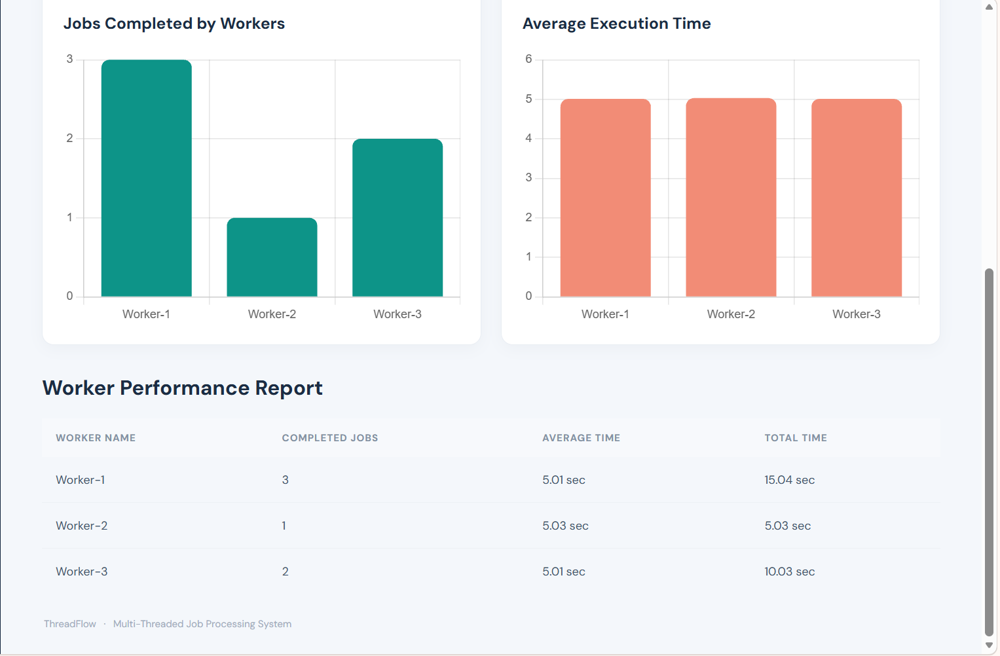

# ⚙️ ThreadFlow – Multi-Threaded Job Processing System

<p align="center">
  <strong>A Web-Based Multithreaded Job Processing Application</strong>
</p>

<p align="center">
  Built using Python, Flask, SQLite, HTML, CSS and JavaScript
</p>

---

## 📌 Project Overview

**ThreadFlow – Multi-Threaded Job Processing System** is a web-based application developed to demonstrate the practical implementation of Operating System concepts such as multithreading, concurrency, thread synchronization, inter-thread communication and priority-based job management.

The application allows users to submit jobs, manage job queues, monitor background workers, track execution history and analyze worker performance through an interactive dashboard.

The system uses multiple background worker threads to process jobs and a thread-safe queue to manage job execution.

## 👥 Team Members

This project has been collaboratively developed by the following three team members.

| S. No. | Team Member Name | University Roll Number |
|:---:|---|:---:|
| 1 | Sandeep Yadav | 2401730096 |
| 2 | Sameer Jakhar | 2401730105 |
| 3 | Dhruve Raghu | 2401730001 |

**University:** K.R. Mangalam University  
**Programme:** B.Tech – Computer Science and Engineering (AI & ML)  
**Subject:** Operating Systems  
**Academic Session:** 2026–2027  
**Project Type:** Academic Team Project

---

## ✨ Key Features

- **Interactive Dashboard:** Displays total jobs, completed jobs, pending jobs and running jobs.
- **Job Submission:** Submit jobs with a name, description and priority.
- **Job Queue Management:** View and manage submitted jobs.
- **Search and Filtering:** Search jobs and filter them by status and priority.
- **Multithreaded Processing:** Uses three background worker threads.
- **Priority-Based Processing:** Supports High, Medium and Low priority jobs.
- **Worker Monitoring:** Monitor worker status and assigned jobs.
- **Job Details:** View detailed information about individual jobs.
- **Job Cancellation:** Cancel pending jobs.
- **Job Retry:** Provides functionality to retry failed jobs.
- **Execution History:** View previously processed jobs.
- **Worker Analytics:** Analyze worker performance and execution statistics.
- **SQLite Database:** Stores job information persistently.

---

## 🧠 Operating System Concepts Implemented

| OS Concept | Implementation |
|---|---|
| Multithreading | Multiple worker threads execute jobs |
| Concurrency | Multiple workers process jobs independently |
| Synchronization | Threading Lock protects shared data |
| Producer-Consumer Problem | Queue manages communication between job submission and workers |
| Thread Management | Python threading module |
| Priority-Based Processing | Jobs are selected according to priority |
| Shared Resources | Workers access common job-management data |

---

## 🛠️ Technologies Used

### Frontend
- HTML5
- CSS3
- JavaScript
- Chart.js

### Backend
- Python 3.12
- Flask
- Python Threading
- Python Queue Module

### Database
- SQLite

### Development Tools
- Visual Studio Code
- Git
- GitHub

---

## 📂 Project Structure

```text
MULTITHREADED_JOB_SYSTEM/
│
├── app.py
├── worker_manager.py
├── requirements.txt
├── rename_screenshots.py
│
├── database/
│   └── db.py
│
├── templates/
│   ├── base.html
│   ├── index.html
│   ├── submit_job.html
│   ├── job_queue.html
│   ├── job_details.html
│   ├── worker_monitor.html
│   ├── execution_history.html
│   └── worker_analytics.html
│
├── static/
│   └── css/
│       └── style.css
│
├── screenshots/
│   ├── dashboard.png
│   ├── submit-job.png
│   ├── job-queue-filters.png
│   ├── job-queue-records.png
│   ├── job-details.png
│   ├── worker-monitor.png
│   ├── execution-history.png
│   ├── worker-analytics-overview.png
│   └── worker-analytics-details.png
│
└── README.md
```

---

## 🖥️ Project Screenshots

### 1. Dashboard

The dashboard provides an overview of job statistics and system activity.



### 2. Submit New Job

Allows users to submit jobs by entering job details and selecting priority.



### 3. Job Queue – Search and Filters

Displays the job queue with search and filtering functionality.



### 4. Job Queue – Records

Displays submitted jobs, their priorities, statuses and available actions.



### 5. Job Details

Displays detailed information about a selected job, including its execution information.



### 6. Worker Monitoring

Displays the status of background workers and their assigned jobs.



### 7. Execution History

Displays recorded job execution information.



### 8. Worker Analytics – Overview

Provides an overview of worker performance and job distribution.



### 9. Worker Analytics – Details

Displays detailed worker performance and execution statistics.



---

## ⚙️ Installation and Setup

Follow these steps to run ThreadFlow on your local machine.

### Step 1: Clone the Repository

```bash
git clone https://github.com/Sandeepyadav-prog/Multi-Threaded-Job-Processing-System.git
```

### Step 2: Navigate to the Project Directory

```bash
cd Multi-Threaded-Job-Processing-System
```

### Step 3: Create a Virtual Environment

```bash
python -m venv venv
```

### Step 4: Activate the Virtual Environment

For Windows:

```bash
venv\Scripts\activate
```

### Step 5: Install Required Dependencies

```bash
pip install -r requirements.txt
```

### Step 6: Run the Application

```bash
python app.py
```

### Step 7: Open the Application

Open your browser and visit:

```text
http://127.0.0.1:5000
```

---

## 🔄 Working Procedure

The system follows a producer-consumer approach for job processing.

1. The user submits a job through the web interface.
2. The application stores the job information in the SQLite database.
3. Pending jobs are selected according to their priority.
4. Job IDs are inserted into a thread-safe queue.
5. Three background worker threads retrieve jobs from the queue.
6. Each worker marks its assigned job as Running.
7. The system simulates job execution using a five-second processing delay.
8. After processing, the job status is updated to Completed.
9. Worker statistics and job information are displayed through the dashboard and analytics pages.

---

## 📊 Main Application Modules

| Module | Description |
|---|---|
| Dashboard | Displays overall job statistics |
| Submit Job | Allows users to submit new jobs |
| Job Queue | Displays jobs with search and filtering |
| Job Details | Displays individual job information |
| Worker Monitor | Monitors worker status |
| Execution History | Displays recorded job history |
| Worker Analytics | Displays worker performance statistics |

---

## ⚠️ Project Limitations

- Job execution is currently simulated using a five-second delay.
- The processing queue operates within the running application.
- Worker statistics are maintained in memory and reset when the application restarts.
- The application demonstrates application-level multithreading rather than a complete operating-system CPU scheduler.

---

## 🚀 Future Enhancements

- Implement real-world job execution tasks.
- Introduce advanced scheduling algorithms such as FCFS and Round Robin.
- Add user authentication and role